<p align="center">
  <a href="https://antonvynohradov.github.io/isotp-c/">
    
  </a>
</p>

<p align="center">
  <a href="https://antonvynohradov.github.io/isotp-c/"><b>Documentation</b></a> ·
  <a href="https://antonvynohradov.github.io/isotp-c/downloads/ISOTP-C_User_Manual.pdf"><b>PDF user manual</b></a> ·
  <a href="https://github.com/AntonVynohradov/isotp-c/releases"><b>Releases</b></a> ·
  <a href="CHANGELOG.md"><b>Changelog</b></a>
</p>

# ISOTP-C: Hardware-Agnostic ISO 15765-2 (ISO-TP) Library

[](https://github.com/AntonVynohradov/isotp-c/actions/workflows/build-static-lib.yml)
[](https://github.com/AntonVynohradov/isotp-c/actions/workflows/documentation.yml)
[](https://github.com/AntonVynohradov/isotp-c/actions/workflows/google-unit-tests.yml)
[](https://github.com/AntonVynohradov/isotp-c/actions/workflows/static-analysis.yml)

## Overview

ISOTP-C is a C11 implementation of the
[ISO 15765-2 (ISO-TP)](https://www.iso.org/standard/84211.html) transport protocol for
classical CAN: it carries messages of up to 4095 bytes — or longer, with the 32-bit length
of the 2016 edition — over 8-byte CAN frames, as diagnostics (UDS), OBD and CAN bootloaders
need. It does not depend on hardware, an operating system, a clock or a heap, and it is
developed for embedded systems that must comply with **MISRA C:2012**.

It started as a fork of [isotp-c](https://github.com/SimonCahill/isotp-c) by Li Shen and
Simon Cahill. Version 2 is a rewrite with a new, layered API.

### Project Status

✅ **Version 2.0.1.** The API of `isotp.h` changed against 1.x (see
[CHANGELOG.md](CHANGELOG.md)) and is stable within version 2.

The codec and the link are complete and covered by 82 unit tests at 100 % of lines and
branches, and by 62 integration tests against an independent Python implementation. The
Cppcheck MISRA C:2012 addon reports no violations; the three advisory deviations are
documented in [docs/misra.md](docs/misra.md).

---

## About ISO-TP

ISO 15765-2 defines how a message longer than one CAN frame is sent: a **First Frame**
announces the length and carries the first bytes, the receiver answers with a **Flow
Control** frame (block size and minimum separation time), and **Consecutive Frames** with a
4-bit sequence number carry the rest. Messages of up to 7 bytes travel in one **Single
Frame**. Timeouts on both sides (N_Bs, N_Cr) detect a lost peer.

---

## Objectives

### 🎯 Primary Goals

1. **Embedded systems**
   - C11, no heap, no RTOS, no global state; all state in caller-owned structures
   - Time is an argument: no clock, no platform functions
   - Measured footprint: 104 bytes per link plus the message buffers, 120 bytes of stack
     (Cortex-M4 `-Os`), 1.8 KB of code
2. **Testing**
   - GoogleTest unit tests with a 100 % line and branch coverage gate
   - Python twin of the codec, C/Python cross-check, end-to-end tests of the C link
3. **Documentation**
   - Website, printable PDF manual, API reference with every return value
4. **MISRA C:2012**
   - Cppcheck addon gate in CI, deviation register, manual review notes

## Roadmap

- [x] Layered codec and link, explicit time input, 32-bit FF_DL
- [x] 100 % coverage, MISRA gate, Python twin
- [x] Examples: bare metal (simulated, in CI), Linux SocketCAN, Zephyr
- [x] Release 2.0.1
- [ ] Extended and mixed addressing
- [ ] CAN FD frames (up to 64 bytes)

---

## Building & Usage

### Prerequisites

- C11 compiler, CMake 3.20+
- Optional: GoogleTest, gcovr, Python 3 with pytest, Cppcheck, clang-format, MkDocs
  (`requirements-dev.txt`)

### Build with presets

```bash
cmake --preset "ISOTP[Release]" && cmake --build "build/ISOTP[Release]"
cmake --preset "ISOTP[UnitTests]" && cmake --build "build/ISOTP[UnitTests]" --target coverage
cmake --preset "ISOTP[IntegrationTests]" && cmake --build "build/ISOTP[IntegrationTests]" --target integration_tests
cmake --preset "ISOTP[Examples]" && cmake --build "build/ISOTP[Examples]" && ctest --test-dir "build/ISOTP[Examples]" -L example
cmake --build "build/ISOTP[Release]" --target misra-analyze
```

### Configuration Options

| Option / macro | Default | Meaning |
| --- | --- | --- |
| `ISOTP_TX_BUFFER_SIZE`, `ISOTP_RX_BUFFER_SIZE` | `4095U` | Largest message per direction |
| `ISOTP_DEFAULT_*` | see `inc/isotp_config.h` | Defaults for BS, STmin, N_Bs, N_Cr, N_WFTmax |
| `ISOTP_UNIT_TESTS`, `ISOTP_INTEGRATION_TESTS`, `ISOTP_EXAMPLES` | `OFF` | Test suites and examples |
| `ISOTP_COVERAGE_MIN` | `100` | Coverage gate |
| `ISOTP_MISRA_FAIL_ON_VIOLATION` | `ON` | MISRA gate |

### Using the library in another CMake project

```cmake
include(path/to/isotp-c/isotp.cmake)
target_link_libraries(app PRIVATE isotp)
```

### Quick Start Example

```c
#include "isotp.h"

static struct isotp_link link;

static int can_write(void* context, uint32_t can_id, const uint8_t* data, size_t length)
{
    (void) context;
    return board_can_write(can_id, data, length);
}

static void on_message(const uint8_t* data, uint32_t length, void* context)
{
    (void) context;
    (void) isotp_link_send(&link, data, length, board_micros()); /* echo */
}

int main(void)
{
    struct isotp_link_config config;
    uint8_t frame[8];
    uint32_t can_id;

    isotp_link_config_default(&config);
    config.tx_id = 0x7E8U;
    config.write = can_write;
    config.on_message = on_message;
    (void) isotp_link_init(&link, &config);

    for (;;)
    {
        size_t length = board_can_read(&can_id, frame);
        if ((length > 0U) && (can_id == 0x7E0U))
        {
            isotp_link_receive(&link, frame, length, board_micros());
        }
        isotp_link_poll(&link, board_micros());
    }
}
```

---

## Project Structure

```
isotp-c/
├── isotp.h                  umbrella header, version fallbacks
├── inc/                     isotp_config.h, isotp_defs.h, isotp_protocol.h, isotp_link.h
├── src/                     isotp_protocol.c, isotp_link.c
├── tests/
│   ├── unit/                GoogleTest (82 tests)
│   └── integration/         pytest, Python twin (isotp/protocol.py), C harness
├── examples/                bare_metal/, linux_socketcan/, zephyr/
├── tools/docs/              diagrams, hero, PDF manual, snippet check, stack usage
├── docs/, overrides/, mkdocs.yml   documentation website
├── cmake/                   version, unit tests, integration tests, MISRA check
├── .github/                 CI workflows, PR template, review guidelines
├── .agents/skills/isotp-c/  project skill for AI coding agents
├── isotp.cmake, CMakeLists.txt, CMakePresets.json
└── CHANGELOG.md, CITATION.cff, LICENSE (MIT)
```

## Tools

| Tool | Purpose |
| --- | --- |
| `tools/docs/diagrams.py` | Generates every diagram and the hero image |
| `tools/docs/check_snippets.py` | Compiles every C snippet of the documentation |
| `tools/docs/stack_usage.py` | Worst-case stack per public function |
| `tools/docs/build_manual.py` | Printable PDF manual |

## Documentation

- Website: <https://antonvynohradov.github.io/isotp-c/>
- PDF manual: built by CI and attached to every release
- Locally: `mkdocs serve`, `python tools/docs/build_manual.py`

## Author

**Anton Vynohradov** — Embedded Systems Engineer · Secure Product Architect · Founder of
SystemFromScratch®

- Website: [systemfromscratch.com](https://systemfromscratch.com)
- GitHub: [AntonVynohradov](https://github.com/AntonVynohradov)
- LinkedIn: [vynohradov](https://www.linkedin.com/in/vynohradov)
- ORCID: [0009-0005-6965-0911](https://orcid.org/0009-0005-6965-0911)
- E-mail: [avynohradov@systemfromscratch.com](mailto:avynohradov@systemfromscratch.com)

## Releases & Versioning

Semantic Versioning; the version comes from the `vX.Y.Z` Git tag. A tag on `main` runs the
release workflow: version check, all quality gates, static library package, MISRA report
and PDF manual as a GitHub Release. See [CHANGELOG.md](CHANGELOG.md).

## Contributing

Pull requests to `development`. Every change keeps 100 % coverage, 0 MISRA violations,
clean `clang-format` and compiling documentation snippets; see
[Extending the Library](https://antonvynohradov.github.io/isotp-c/extending/#contributing-to-the-library).

## License

MIT License — © 2019-2024 Li Shen & Co-Operators, © 2024 Simon Cahill & Contributors,
© 2026 Anton Vynohradov. See [LICENSE](LICENSE).

SystemFromScratch® is a registered trademark. The MIT License grants no rights to use the
SystemFromScratch® name or logo; they may not be used to endorse or promote products
derived from ISOTP-C without prior written permission. ISO 15765-2 is a standard of the
International Organization for Standardization (ISO); ISOTP-C is an independent
implementation and is not affiliated with or endorsed by ISO.

## References

- [ISO 15765-2 — Road vehicles — Diagnostic communication over Controller Area Network (DoCAN) — Part 2: Transport protocol and network layer services](https://www.iso.org/standard/84211.html)
- [isotp-c by Li Shen and Simon Cahill](https://github.com/SimonCahill/isotp-c)
