# Author & Company

{ .sfs-brand__logo }

ISOTP-C is designed, written and maintained by **Anton Vynohradov** and published by
**SystemFromScratch®** — secure embedded systems and compliance-ready engineering, from
concept to certification.

## Author

**Anton Vynohradov** · [ORCID 0009-0005-6965-0911](https://orcid.org/0009-0005-6965-0911)
{ .sfs-author__name }

Embedded Systems Engineer · Secure Product Architect · Founder of SystemFromScratch®
{ .sfs-author__role }

*Embedded systems built from scratch — from bare metal to Linux, from first schematic to
certification.*

Anton designs and builds reliable, secure embedded products end to end: firmware, board
support packages and drivers, RTOS and Embedded Linux platforms, hardware bring-up, and
the security and compliance work needed to ship them. He is based in Poland and works
remotely worldwide.

| Area | Focus |
| --- | --- |
| Embedded software | Bare-metal, RTOS and Linux firmware in C/C++, built to be maintained for years |
| BSP & drivers | Bootloaders, Zephyr drivers and Linux kernel work for MCUs, SoCs and SoC FPGAs |
| Security & compliance | Secure boot, threat modelling, MISRA C/C++, EU Cyber Resilience Act (CRA) readiness |
| Industries | Industrial IoT, automotive, robotics, medical and consumer electronics |

**Technology:** C · C++ · Python · Zephyr RTOS · FreeRTOS · Embedded Linux · Yocto ·
Buildroot · ARM Cortex-M · STM32 · Microchip FPGA · RISC-V · CAN / ISO-TP · ROS 2 ·
Docker · Git · CI/CD · MISRA C/C++ · EU CRA

For ISOTP-C, Anton rewrote the library that started as a fork of isotp-c by Li Shen and
Simon Cahill: the layered codec and link of version 2, the unit and integration tests
with the Python twin, the examples and this documentation.

## SystemFromScratch®

SystemFromScratch® was founded by Anton Vynohradov. The company combines deep embedded
engineering with cybersecurity and certification-focused product development, for teams
in industrial IoT, automotive, robotics, medical and consumer electronics that need a
partner who understands the whole stack — silicon, firmware, operating system and the
regulations that govern them.

| Service | What it covers |
| --- | --- |
| Embedded software development | Bare-metal, RTOS and Linux firmware for performance, reliability and long-term maintainability |
| BSP & device drivers | Board support packages, bootloaders and low-level drivers for MCUs, SoCs, FPGAs and custom hardware |
| RTOS & Embedded Linux | Zephyr, FreeRTOS and Embedded Linux (Yocto, Buildroot): porting, configuration, integration, reproducible builds |
| Hardware bring-up & integration | Schematic review, first boot, validation and production support, including SoC FPGA and motor-control platforms |
| Cybersecurity & CRA readiness | Secure boot, firmware integrity, threat modelling and a secure development lifecycle for the EU Cyber Resilience Act |
| Compliance & consulting | MISRA C/C++, static analysis, code and architecture reviews, compliance roadmaps |

ISOTP-C is one of the open-source projects in the SystemFromScratch® portfolio: public
engineering work that can be inspected line by line, built with the same rules — MISRA C,
full test coverage, documented decisions — that the company applies to customer products.

## Contact

| Channel | Address |
| --- | --- |
| Website | [systemfromscratch.com](https://systemfromscratch.com) |
| E-mail | [avynohradov@systemfromscratch.com](mailto:avynohradov@systemfromscratch.com) |
| GitHub | [github.com/AntonVynohradov](https://github.com/AntonVynohradov) |
| GitHub organization | [github.com/SystemFromScratch](https://github.com/SystemFromScratch) |
| LinkedIn | [linkedin.com/in/vynohradov](https://www.linkedin.com/in/vynohradov) |
| ORCID | [0009-0005-6965-0911](https://orcid.org/0009-0005-6965-0911) |
| Location | Poland — working remotely worldwide |

Building a connected product, bringing up new hardware, or preparing for the Cyber
Resilience Act? Get in touch through [systemfromscratch.com](https://systemfromscratch.com)
or by e-mail.

## Support and feedback

- **Bugs and feature requests:** open an issue on
  [GitHub](https://github.com/AntonVynohradov/isotp-c/issues). Please include the library
  version, your compiler and target, and — for communication problems — a capture of
  the bytes on the bus.
- **Contributions:** see [Contributing to the library](extending.md#contributing-to-the-library).
- **Commercial support, integration and custom development:** contact SystemFromScratch®
  through [systemfromscratch.com](https://systemfromscratch.com).

## Trademarks and acknowledgements

SystemFromScratch® is a registered trademark. The SystemFromScratch® name and logo are used
in this documentation to identify the publisher of ISOTP-C; the MIT License grants
no rights to use them, and they may not be used to endorse or promote products derived
from ISOTP-C without prior written permission.

ISOTP-C implements the transport protocol published by ISO in
[ISO 15765-2](https://www.iso.org/standard/84211.html). The test vectors are built from
the frame layout of that standard. ISOTP-C is an independent implementation and is not
affiliated with or endorsed by ISO.

Version 1 of this library was derived from
[isotp-c](https://github.com/SimonCahill/isotp-c) by Li Shen and Simon Cahill, released
under the MIT License; their copyright notices are kept in the [license](LICENSE.md).
