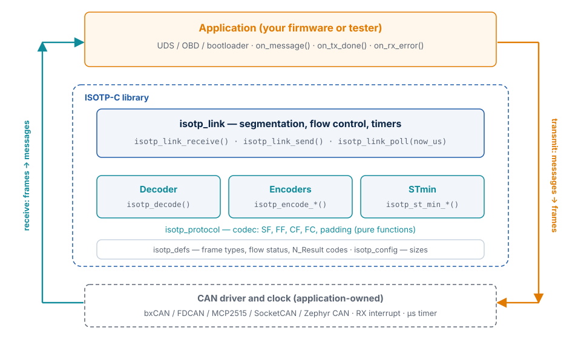
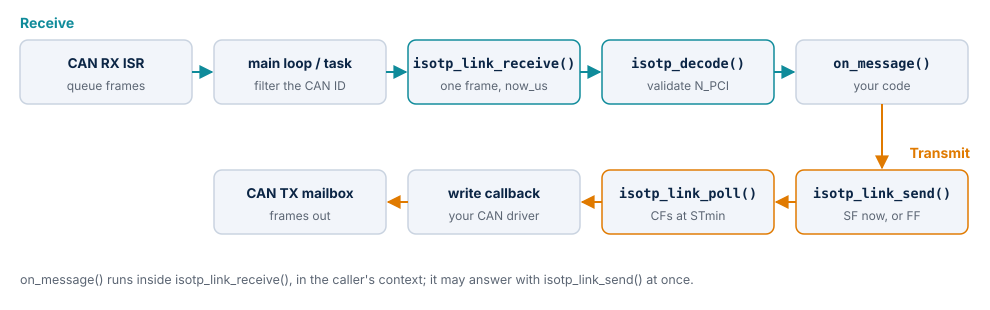
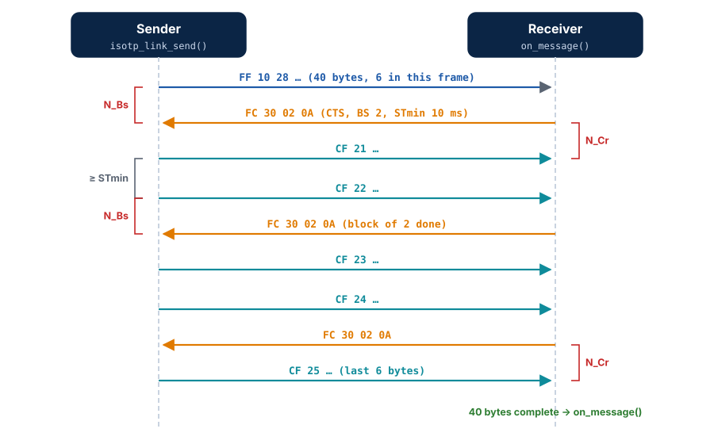
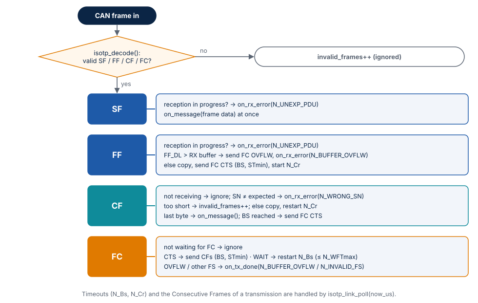

# How It Works

This chapter explains how ISOTP-C is built: its layers, how frames and messages flow
through it, the transmitter and receiver state machines with their timers, how errors are
reported, and why it is designed this way.

## Layers

| Layer | Header | Responsibility |
| --- | --- | --- |
| Definitions | `isotp_defs.h` | Frame types, flow status values, frame layout limits, return and N_Result codes, big-endian helpers. No state. |
| Configuration | `isotp_config.h` | Buffer sizes and protocol defaults, range-checked at compile time. |
| Codec | `isotp_protocol.h` | `isotp_decode()` validates one CAN frame and describes it in a `struct isotp_pdu`; `isotp_encode_*()` write one frame; `isotp_frame_pad()`; STmin conversion. Pure functions over caller buffers. |
| Link | `isotp_link.h` | One connection to one peer: copies outgoing messages, sends FF and CFs under the receiver's flow control, reassembles incoming messages, answers with Flow Control, runs the N_Bs and N_Cr timers, reports results. |

Each layer depends only on the ones below it. The codec can be used without the link, for
example in a bus monitor that only decodes frames.

## Data flow

**Receive path.** Your CAN interrupt stores the frame; your task or main loop takes it
out, checks that its CAN ID belongs to this link and calls `isotp_link_receive()` with the
current time. The link decodes the frame and acts on it. A Single Frame is delivered to
`on_message()` straight from the frame data; the frames of a segmented message are copied
into the link's receive buffer, and `on_message()` is called when the last byte has
arrived. The link writes its Flow Control frames itself, through your write function.

**Transmit path.** `isotp_link_send()` sends a message of up to 7 bytes at once as a Single
Frame. A longer message is copied into the link's transmit buffer and its First Frame is
written; then the link waits for the receiver's Flow Control frame. Each call of
`isotp_link_poll()` sends at most one Consecutive Frame, when the separation time has
passed and the block is not finished. When the last frame has been written, the link
calls `on_tx_done(ISOTP_N_OK)`.

## Segmentation and flow control

A message that does not fit a Single Frame is sent as a First Frame, which announces the
total length and carries the first 6 bytes, followed by Consecutive Frames of up to 7
bytes with a 4-bit sequence number that starts at 1 and wraps from 15 to 0. After the First
Frame and after every block of BS Consecutive Frames, the sender waits for a Flow Control
frame from the receiver:

| Flow status | Sender |
| --- | --- |
| CTS (continue to send) | Sends the next block of BS frames (BS = 0: all remaining frames) with at least STmin between two frames |
| WAIT | Keeps waiting and restarts N_Bs; more than N_WFTmax Wait frames in a row end the transmission with `ISOTP_N_WFT_OVRN` |
| OVFLW (overflow) | Ends the transmission with `ISOTP_N_BUFFER_OVFLW` |
| other value | Ends the transmission with `ISOTP_N_INVALID_FS` |

The receiver answers a First Frame with CTS and its own BS and STmin
(`isotp_link_config::block_size`, `::st_min_us`), and repeats the CTS after every BS
Consecutive Frames. It answers with OVFLW when the announced length does not fit
`ISOTP_RX_BUFFER_SIZE`. The library never sends WAIT: its receive buffer is always ready.

## The receiver

1. **Decode.** `isotp_decode()` rejects what ISO 15765-2 tells a receiver to ignore: a
   reserved frame type, SF_DL 0 or longer than the frame, a First Frame shorter than 8
   bytes or announcing a message that would fit a Single Frame, an escape-sequence First
   Frame with a length up to 4095, a Consecutive Frame without data, a Flow Control frame
   shorter than 3 bytes. Rejected frames are counted (`isotp_link_invalid_frames()`).
2. **Single or First Frame.** If a reception is in progress, it ends with
   `on_rx_error(ISOTP_N_UNEXP_PDU)` and the new frame is processed: a Single Frame is
   delivered at once, a First Frame starts a new reception.
3. **Consecutive Frame.** Ignored when no reception is in progress. A wrong sequence number
   ends the reception with `ISOTP_N_WRONG_SN`. A frame that carries fewer bytes than are
   still expected is counted as invalid and ignored. Otherwise its bytes are copied, N_Cr
   restarts, and the message is delivered when it is complete.
4. **Flow Control frame.** Handled by the transmitter when it waits for one (see above);
   ignored otherwise.
5. **Timeout.** `isotp_link_poll()` ends a reception with `ISOTP_N_TIMEOUT_CR` when no
   Consecutive Frame arrived within N_Cr.

!!! note "Recovery after errors"
    After any error the receiver is idle and accepts the next Single or First Frame. ISO-TP
    has no retransmission: the sender learns about a receiver error only by its own
    timeout (N_Bs) or by an Overflow, and the application (for example the UDS client)
    repeats the request.

## The transmitter

| State | Entered when | Leaves on |
| --- | --- | --- |
| `ISOTP_TX_IDLE` | init, end of a transmission | `isotp_link_send()` of more than 7 bytes |
| `ISOTP_TX_WAIT_FC` | First Frame written; block of BS frames written | FC CTS → `SEND_CF`; FC WAIT (≤ N_WFTmax) → stays; FC OVFLW, invalid FS, too many WAIT, N_Bs expired → `IDLE` with an error |
| `ISOTP_TX_SEND_CF` | FC CTS received | last frame written → `IDLE` (`ISOTP_N_OK`); block done → `WAIT_FC`; write error → `IDLE` (`ISOTP_N_ERROR`) |

When the write function returns `ISOTP_BUSY` for a Consecutive Frame, the link tries the
same frame again on the next poll. For a Single or First Frame, `isotp_link_send()`
returns the writer's result and nothing is started.

## Time

The library never reads a clock. Every call that can start or check a timer takes
`now_us`, a free-running microsecond counter that may wrap at 2^32. Deadlines are stored
as `now_us + timeout` and compared modulo 2^32, which is correct as long as a timeout is
shorter than 2^31 µs (about 35 minutes); `isotp_link_init()` enforces that. The resolution
you get is the resolution of your counter and of your poll interval: to send at an STmin
of 1 ms, poll at least every millisecond.

## Memory model

| Structure | Contents | Size with the default configuration (Cortex-M4) |
| --- | --- | --- |
| `struct isotp_link` | configuration copy, both message buffers, both state machines, counters | 8 296 bytes |
| `struct isotp_link_config` | CAN ID, callbacks, flow-control and timing parameters | 48 bytes |
| `struct isotp_pdu` | one decoded frame (on the stack inside the link) | 16 bytes |
| Frame buffer | 8 bytes on the stack while one frame is written | 8 bytes |

There is no global state. Every link is independent; an application with three peers
declares three links.

## Error handling

| Situation | Result |
| --- | --- |
| A `NULL` pointer, zero length or a value out of range | `ISOTP_ERROR`; nothing is written or changed |
| `isotp_link_send()` while a segmented transmission is in progress | `ISOTP_BUSY` |
| The write function fails on a Single or First Frame | Its return value is returned by `isotp_link_send()` |
| The write function fails on a Consecutive Frame | `ISOTP_BUSY`: retried on the next poll; other: `on_tx_done(ISOTP_N_ERROR)` |
| The write function fails on a Flow Control frame | `on_rx_error(ISOTP_N_ERROR)`; the reception ends |
| Malformed frame | Ignored, `isotp_link_invalid_frames()` + 1 |
| Protocol error or timeout | `on_tx_done()` / `on_rx_error()` with the N_Result code; also readable with `isotp_link_tx_result()` / `isotp_link_rx_result()` |

## Threading and reentrancy

- **Codec functions** are reentrant: they only touch their arguments.
- **A link** is not thread-safe. Call `isotp_link_receive()`, `isotp_link_poll()` and
  `isotp_link_send()` of one link from one context — a CAN task or the main loop, not the
  CAN interrupt — or protect all three with one mutex.
- **Callbacks** run in the caller's context, inside `isotp_link_receive()`,
  `isotp_link_poll()` or `isotp_link_send()`. They may call `isotp_link_send()` on the
  same link: the link updates its state before it calls them.
- **The message data** passed to `on_message()` is valid only during the call.

## Design decisions

| Decision | Reason |
| --- | --- |
| Time is an argument (`now_us`) | No dependency on an OS or timer driver; tests control time exactly; works with any clock source. |
| One Consecutive Frame per poll | Bounded execution time per call; the CAN driver's queue is never flooded; STmin below the poll interval is still met because frames are never sent early. |
| The link copies outgoing messages | The caller may reuse its buffer at once; no lifetime rules for the payload. |
| Buffers sized at build time | No heap; the RAM per link is known at link time and in the map file. |
| STmin rounded up when encoded | The sender is never asked to go faster than the receiver needs. |
| Reserved STmin values read as 127 ms | Required by ISO 15765-2 for senders. |
| Single Frame delivered from the frame | No copy for the most common case (short requests). |
| Separate write and application contexts | The driver and the application layer are usually different modules. |
| Functional addressing only for Single Frames | ISO 15765-2 does not allow segmented messages to functional addresses. |
