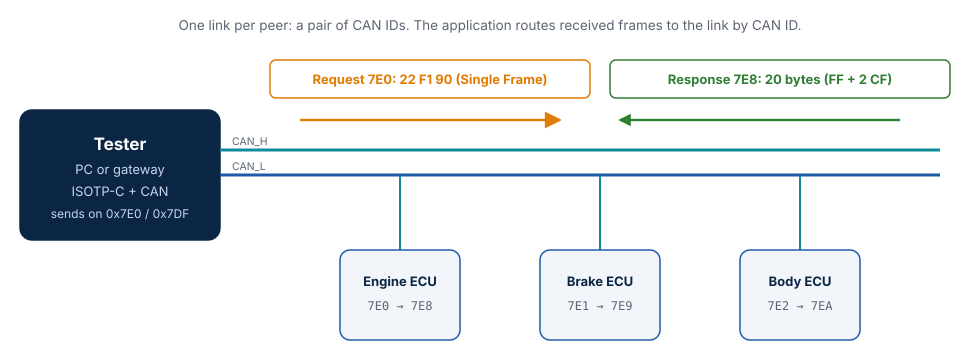
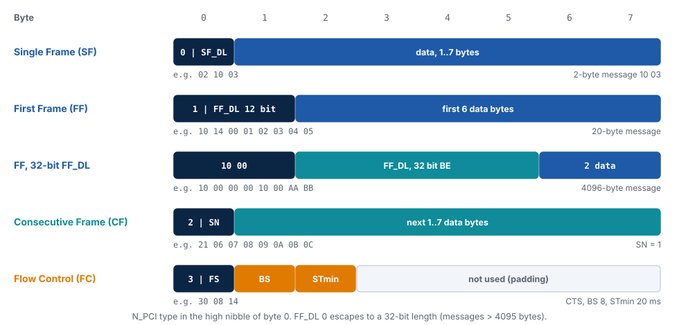

# ISO 15765-2 (ISO-TP)

This chapter describes the ISO 15765-2 wire format for classical CAN with normal
addressing and exactly what ISOTP-C does with each part of it. The normative reference is
the [standard](https://www.iso.org/standard/84211.html); ISOTP-C includes the 32-bit
message length introduced by the 2016 edition.

## The bus

ISO-TP runs on top of CAN. Each direction between two nodes uses its own CAN ID — in
diagnostics, for example, the tester sends to an ECU on 0x7E0 and the ECU answers on
0x7E8 — and a functional ID (0x7DF) addresses all ECUs at once. One ISOTP-C link is one
such pair of IDs: it sends with `tx_id`, and the application gives it the frames of the
peer's ID. Both directions of a link work at the same time (full duplex).

## Frames

The first byte, or the first two bytes, of every frame are the protocol control
information (N_PCI). Its high nibble is the frame type:

| Type | Byte 0 | Further N_PCI | Data | Use |
| --- | --- | --- | --- | --- |
| Single Frame (SF) | `0` \| SF_DL | — | 1..7 bytes | A whole message of up to 7 bytes |
| First Frame (FF) | `1` \| FF_DL bits 11..8 | byte 1: FF_DL bits 7..0 | 6 bytes | Start of a message of 8..4095 bytes |
| First Frame, escape | `10` | byte 1 `00`, bytes 2..5: FF_DL, 32 bit, big-endian | 2 bytes | Start of a message of more than 4095 bytes |
| Consecutive Frame (CF) | `2` \| SN | — | 1..7 bytes | Next part of the message |
| Flow Control (FC) | `3` \| FS | byte 1: BS, byte 2: STmin | — | The receiver's answer to an FF and after every block |

A First Frame is always 8 bytes long. The last Consecutive Frame carries the remaining
bytes; with padding, the rest of the frame is filled with the padding byte.

## Flow status, block size and separation time

| Field | Values | Meaning |
| --- | --- | --- |
| FS | `0` CTS, `1` WAIT, `2` OVFLW | Continue to send / wait for the next FC / message too long for the receiver |
| BS | `0` … `255` | Consecutive Frames the sender may send before the next FC; `0`: all |
| STmin | `00` … `7F` | Minimum time between two Consecutive Frames, 0..127 ms |
| STmin | `F1` … `F9` | 100..900 µs |
| STmin | other values | Reserved; a sender treats them as `7F` (127 ms) |

`isotp_st_min_encode()` rounds a requested time up to the next value that can be encoded,
so the sender never goes faster than asked; `isotp_st_min_decode()` maps the reserved
values to 127 ms.

## Timers and N_Result

| Timer | Side | Runs from … to … | Default | On expiry |
| --- | --- | --- | --- | --- |
| N_Bs | Sender | FF or last CF of a block written → FC received | 1000 ms | `ISOTP_N_TIMEOUT_BS` |
| N_Cr | Receiver | FC written or CF received → next CF received | 1000 ms | `ISOTP_N_TIMEOUT_CR` |

ISO 15765-2 also defines N_As/N_Ar (time for the CAN driver to send a frame) and the
performance times N_Br/N_Cs. ISOTP-C writes frames synchronously through your write
function, so it does not time them: `ISOTP_N_TIMEOUT_A` is never produced.

| N_Result | Reported when |
| --- | --- |
| `ISOTP_N_OK` | The message was sent or received completely |
| `ISOTP_N_TIMEOUT_BS` | No Flow Control frame within N_Bs |
| `ISOTP_N_TIMEOUT_CR` | No Consecutive Frame within N_Cr |
| `ISOTP_N_WRONG_SN` | A Consecutive Frame with an unexpected sequence number |
| `ISOTP_N_INVALID_FS` | A Flow Control frame with an unknown flow status |
| `ISOTP_N_UNEXP_PDU` | A Single or First Frame interrupted a reception |
| `ISOTP_N_WFT_OVRN` | More than N_WFTmax Flow Control frames with WAIT in a row |
| `ISOTP_N_BUFFER_OVFLW` | Sender: the receiver answered OVFLW. Receiver: the announced message is longer than `ISOTP_RX_BUFFER_SIZE` |
| `ISOTP_N_ERROR` | The write function failed while sending a frame |

## Receiver behavior

What the receiver of ISOTP-C does with every frame, following ISO 15765-2:

| Frame | Condition | Action |
| --- | --- | --- |
| any | Reserved type, SF_DL 0 or longer than the frame, FF not 8 bytes, FF_DL ≤ 7, escape FF_DL ≤ 4095, CF without data, FC shorter than 3 bytes | Ignored, counted as invalid |
| SF | — | Delivered; a reception in progress ends with N_UNEXP_PDU |
| FF | FF_DL fits the buffer | FC CTS sent, reception starts; a reception in progress ends with N_UNEXP_PDU |
| FF | FF_DL too long | FC OVFLW sent, N_BUFFER_OVFLW |
| CF | No reception in progress | Ignored |
| CF | Wrong SN | Reception ends with N_WRONG_SN |
| CF | Fewer data bytes than still expected | Ignored, counted as invalid |
| FC | Not waiting for FC | Ignored |

Frames longer than needed (padding) are accepted in every case.

## Scope of this implementation

| Feature of ISO 15765-2 | ISOTP-C |
| --- | --- |
| Normal addressing, 11- and 29-bit CAN IDs | Yes |
| Normal fixed addressing (29-bit IDs with source and target address) | Yes, through `tx_id` and your routing |
| Extended and mixed addressing | No |
| Classical CAN (8 bytes) | Yes |
| CAN FD (up to 64 bytes) | No |
| 32-bit FF_DL (messages > 4095 bytes) | Yes |
| Functional addressing | Single Frames, as required |
| Sending FC WAIT | No (the receive buffer is always ready) |

## Reference frames used in the tests

The ISO standard is not freely available, so the test frames are built from its frame
layout. They are checked in `tests/unit/gtest_isotp_decode.cpp`,
`tests/unit/gtest_isotp_encode.cpp` and `tests/integration/test_protocol.py`.

| Frame | Bytes |
| --- | --- |
| SF, UDS DiagnosticSessionControl (extended session) | `02 10 03` |
| SF, 7 bytes | `07 00 01 02 03 04 05 06` |
| FF, 20-byte message | `10 14 00 01 02 03 04 05` |
| FF, 4095-byte message | `1F FF 00 01 02 03 04 05` |
| FF, 4096-byte message (escape) | `10 00 00 00 10 00 AA BB` |
| CF, SN 1 | `21 06 07 08` |
| FC, CTS, BS 8, STmin 20 ms | `30 08 14` |
| FC, OVFLW | `32 00 00` |
